<p align="center">
  <picture>
    <source media="(prefers-color-scheme: dark)" srcset="landing/brand/fframes-wordmark-dark.svg" />
    
  </picture>
</p>

<p align="center">
  <b>Video vibe coding framework that is actually fast.</b>
</p>

<p align="center">
  <a href="https://crates.io/crates/fframes"></a>
  <a href="https://docs.rs/fframes"></a>
  <a href="./LICENSE.txt"></a>
  <a href="https://x.com/fframes_rust"></a>
</p>

https://github.com/user-attachments/assets/9fdfd7b6-121b-4b49-bbf4-6f34d240f3a5

---

## What is it for 

fframes is a framework for rendering videos from code. Assuming you are not going to write the thousands lines of code fora video yourself our goal is **quick and efficient** iteration speed for your AI agent, **great and useful real time preview for you**, and **fastest in industry rendering speed** (we are over 30x faster than remotion).

## Get started 

Start with a skill and ask your favorite AI agent to make something you want. Then iterate.

```sh
npx skills add https://fframes.studio
```

## Here is how your videos composed in the code 

Every frame is an SVG tree returned by a Rust function, written with the `svgr!` macro. From
[examples/hello-world](examples/hello-world/src/hello_world.rs), shortened: a square moves along a timeline and a line
of text prints the current frame.

<details>
<summary><b>Show the code</b></summary>

```rust
impl Video for HelloWorldVideo<'_> {
    const FPS: usize = 30;
    const WIDTH: usize = 1920;
    const HEIGHT: usize = 1080;

    fn duration(&self) -> fframes::Duration<'_> {
        fframes::Duration::Seconds(30.)
    }

    fn audio(&self) -> AudioMap<'_> {
        AudioMap::none()
    }

    fn render_frame(&self, frame: Frame, ctx: &FFramesContext) -> fframes::Svgr<'_> {
        fframes::svgr!(
            <svg
                xmlns="http://www.w3.org/2000/svg"
                viewBox="0 0 1920 1080"
                width={ctx.current_video_size.width}
                height={ctx.current_video_size.height}
            >
                <rect
                    x="400"
                    y="400"
                    width="200"
                    height="200"
                    fill="blue"
                    transform={frame.animate(fframes::timeline!(
                        at 0., animate Transform::translate(0, 0) => Transform::translate(200, 480), Easing::Linear,
                        at 2. => 6.0, animate Transform::translate(200, 480) => Transform::translate(750, -400), Easing::Linear,
                        at 6.0 => 10.0, animate Transform::translate(750, -400) => Transform::translate(1310, 480), Easing::Linear,
                    ))}
                />

                <text
                    x="100"
                    y="440"
                    font-family="JetBrains Mono"
                    font-size="74"
                    font-weight="500"
                    fill="#3b5563"
                >
                    {format!("This frame index: {}, second: {:.2}", frame.index, frame.seconds())}
                </text>
            </svg>
        )
    }
}
```

</details>

## Inspiration

Here is a list of some of the examples we store in the repo. Feel free to ~~inspire~~ steal them for your videos. Click an example name to browse its source, or a poster for a preview.

#### [fframes-intro](examples/fframes-intro)

The 128 second [launch video](https://x.com/0xfflock/status/2104432561200279774), everything placed on the beat grid of its soundtrack.

<a href="https://github.com/user-attachments/assets/9fdfd7b6-121b-4b49-bbf4-6f34d240f3a5">
  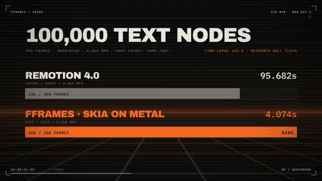
</a>

#### [made-of-motion](examples/made-of-motion)

A 20 second promo with pixel objects, a perspective carousel, thermal shaders and per-exposure vector ink, an adaptation of a reference film.

<a href="https://github.com/user-attachments/assets/3c51ccae-3541-4c79-817c-f544cf83e415">
  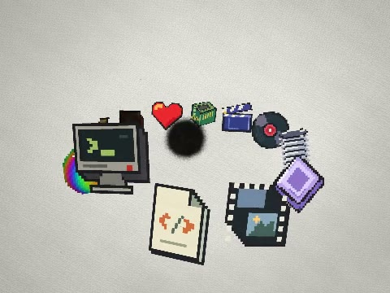
</a>

#### [hello-world](examples/hello-world)

A simple "hello world" video. A good start if you want to really read the code.

<a href="https://github.com/user-attachments/assets/4731c533-c120-44d0-8022-e09600d0c52f">
  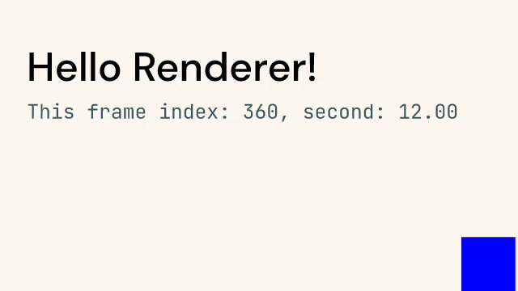
</a>

#### [arm](examples/arm)

An animated robo arm movement video using 3D capabilities.

<a href="https://github.com/user-attachments/assets/f752ebc6-6d7c-4304-abb6-27becc64801c">
  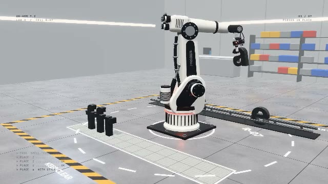
</a>

#### [signal-lab](examples/signal-lab)

A 24 second motion study: product UI, data storytelling and a technical explainer.

<a href="https://github.com/user-attachments/assets/d03e5fe7-4782-4a67-9571-e435ed367477">
  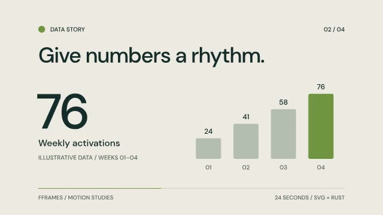
</a>


#### [beta](examples/beta)

A complicated multi-scene example (our beta announce video).

<a href="https://github.com/user-attachments/assets/fee736cc-e6e4-4ad6-b2a8-ca2ad287ab53">
  
</a>

#### [marketing](examples/marketing)

Our announcement video from 2021. With audio visualization.

<a href="https://github.com/user-attachments/assets/963e7f80-e13a-44a2-95de-63684e175006">
  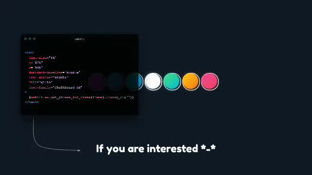
</a>

#### [shaders](examples/shaders)

GPU shader layers composed with SVG: an SkSL background and a Shadertoy raymarcher clipped into a card.

<a href="https://github.com/user-attachments/assets/2a97f8d0-abb9-4b24-9149-cde560b1efcb">
  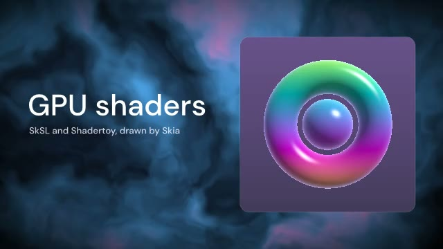
</a>

#### [shader-mode](examples/shader-mode)

A 31-second shader promo with reference audio, a moving panel wall, native preview footage and 18 GPU shader programs, rendered with Skia on Metal or Vulkan.

The preview is silent: its soundtrack is not in the repository.

<a href="https://github.com/user-attachments/assets/53bed61f-6478-471b-81c1-125a3054ee18">
  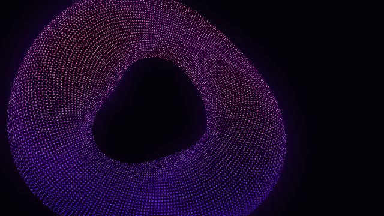
</a>

#### [neon-triangle](examples/neon-triangle)

A minimal shader clip built to make banding and motion artifacts easy to spot.

<a href="https://github.com/user-attachments/assets/8f15791f-0dc4-4589-bec4-c63e4ec0f912">
  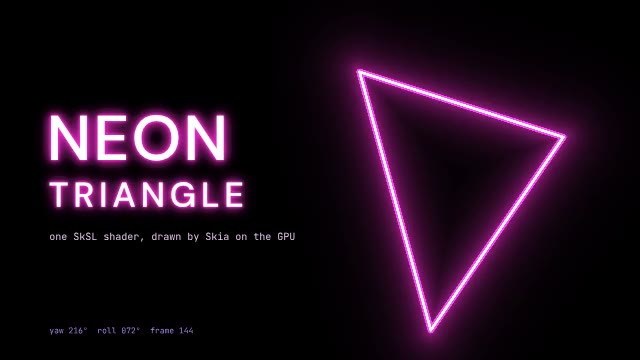
</a>


#### [svg-in-3d](examples/svg-in-3d)

An svgr UI on the screen of a turning 3D monitor, showing a 3D cube with the svgr logo: four nested levels of SVG and 3D that never leave the GPU.

<a href="https://github.com/user-attachments/assets/09432a37-4bd9-42ac-b068-ce92f59695af">
  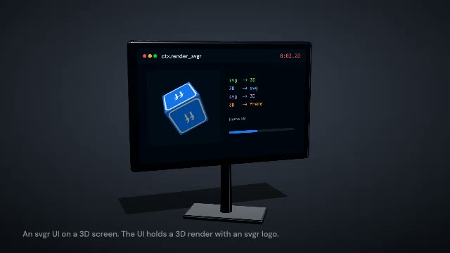
</a>

#### [captions](examples/captions)

A showcase of different effects available for `Captions` module in fframes

<a href="examples/_previews/captions.png">
  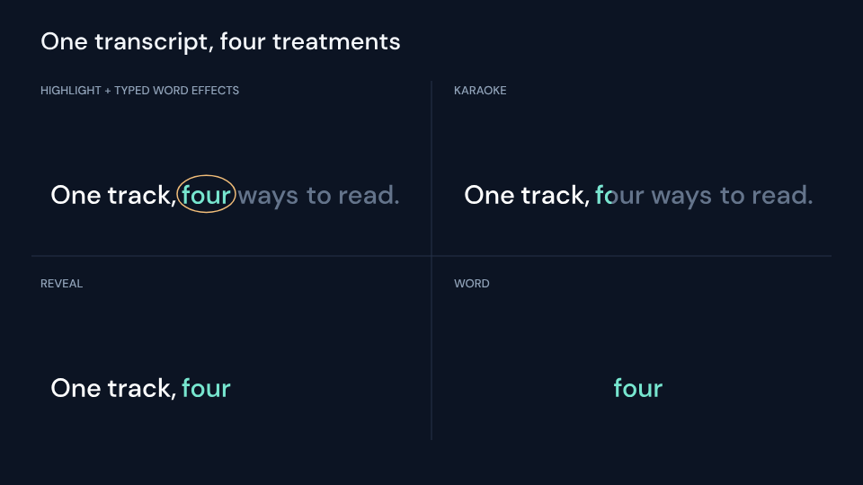
</a>

#### [audio-announce](examples/audio-announce)

Beautiful sound waves audio visualization + subtitles for your video.

<a href="https://github.com/user-attachments/assets/2b6706b8-562d-41fe-97aa-cc8198980001">
  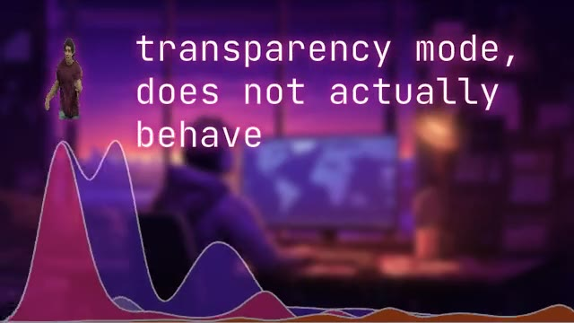
</a>

#### [podcast](examples/podcast)

An audio visualization for a podcast placeholder video.

<a href="https://github.com/user-attachments/assets/602f32c6-4c4c-4d07-b5e9-da5e9dfe80ad">
  
</a>

#### [teej-podcast](examples/teej-podcast)

Teej's podcast with 2 speakers video and chapters visualization.

<a href="https://github.com/user-attachments/assets/fb57ae04-f908-4787-9ef0-bd440d36b1a4">
  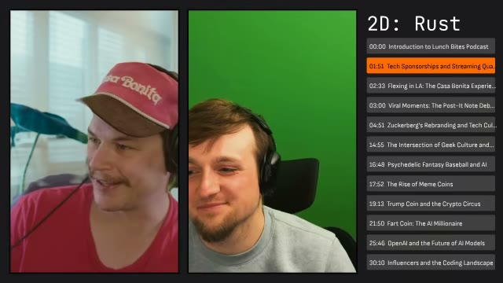
</a>


#### [tiktok](examples/tiktok)

A TikTok-like vertical video with audio visualization 

<a href="https://github.com/user-attachments/assets/20dda3c9-8c44-4ea9-9663-860527d635be">
  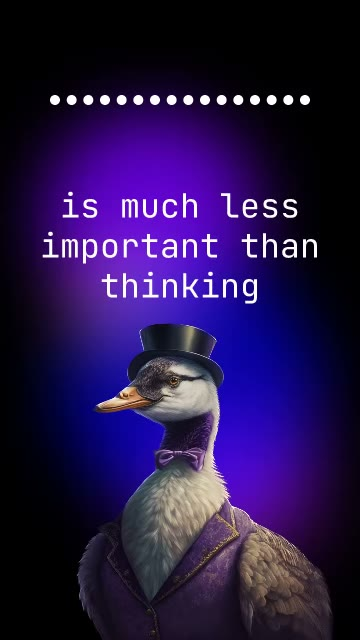
</a>

#### [lottie](examples/lottie)

An 18 second vertical launch video for Lottie support: every animation is a Lottie file and the music is synthesized in Rust.

<a href="https://github.com/user-attachments/assets/3736d334-624b-42b5-870d-0afd39cfe3ff">
  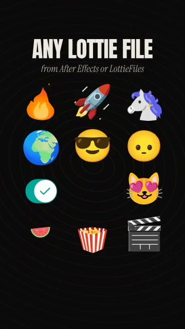
</a>

#### [conference-splash-screen](examples/conference-splash-screen)

One splash screen per conference talk, rendered in batch.

<a href="https://github.com/user-attachments/assets/066d349e-aad6-4d03-b76b-25ad8ccdf8eb">
  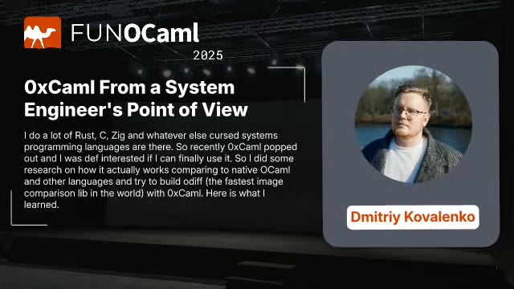
</a>

#### [low-poly-art](examples/low-poly-art)

A renderer stress test: animal art with a lot of polygons.

<a href="https://github.com/user-attachments/assets/71f0b506-e37b-4e56-8064-b9bbc57cdfad">
  
</a>

#### [pixel-memory](examples/pixel-memory)

My dog's memorial video generator (totally randomized).

<a href="https://github.com/user-attachments/assets/fdddfc5e-72f2-4e5f-8ebe-892b9025ee1f">
  
</a>

## Without an agent

```sh
cargo install --locked cargo-fframes
cargo fframes new my-video
cd my-video && cargo run --release -- preview
```

The preview timeline sits below landscape and square videos and to the left of portrait videos.
Drag the filmstrip to scrub, or click a scene marker to pause on its first frame. Use `[` and `]`
to jump between scenes and `,` and `.` to step one frame. Press `Space` to play or pause, or `T`
to hide the timeline and expand the video.

On macOS the studio tries VideoToolbox for supported source videos and falls back to software
for unsupported formats. `preview --software-decode` uses the CPU for decoding while keeping
the selected drawing backend. Playback and filmstrip workers release idle source decoders.
The GPU preview draws each scene through Skia directly into the window drawable or swapchain.
The default buffer holds up to four prepared scene trees, and only the frame under the pointer
is prepared while you drag the timeline. Decoders reuse the pixel buffers of frames that no
scene tree holds any more. The CPU backend draws directly into the window buffer.

`cargo fframes new` takes `--template single-scene|multi-scene`, `--format landscape|portrait|square|uhd`, `--fps`,
`--title` and `--backend`. On macOS and Linux (arm64, x86_64) the first build downloads prebuilt Skia and ffmpeg
libraries and takes under a minute on a fast machine; other targets and feature combinations
compile them from source (up to ~20 minutes). Later builds take seconds. `--backend cpu` skips Skia (no preview window, slower renders). To track `main`, install with
`--git https://github.com/dmtrKovalenko/fframes`.

## Requirements

[Rust](https://www.rust-lang.org/learn/get-started) and, for working on the editor, [NodeJS](https://nodejs.org/en/download/).
fframes links ffmpeg's libav libraries statically. A prebuilt build is downloaded for macOS and Linux (arm64 and x86_64) and
compiled from source for other targets or `FFMPEG_FORCE_BUILD=1`; either way the system encoders they link against have to be installed.

The examples enable `fframes/build-portable` on native non-Windows targets. CI builds the
whole workspace, combining the examples' x264, x265, VPX and Opus features; no published
FFmpeg archive currently matches that combination, so it falls back to a source build.
Without `build-portable`, that build uses `-march=native -mtune=native`. Caching it and
restoring it on a runner with a different CPU can cause `SIGILL` (illegal instruction).
The feature omits those flags for source builds while keeping matching prebuilt downloads
enabled, and also applies to FFmpeg used by the compile-time media macro.

Within this workspace, use the same setting for native builds that will be cached or run on
other machines:

```toml
[target.'cfg(not(any(target_arch = "wasm32", windows)))'.dependencies]
fframes = { workspace = true, features = ["build-portable"] }
```

`build-portable` also enables FFmpeg's source-build support, so the examples exclude Windows
(which links a shared FFmpeg installation) and browser targets. Setting `FFMPEG_MARCH` or
`FFMPEG_MTUNE`, even to an empty string, bypasses prebuilt downloads; prefer the feature when
you want portable source fallbacks and prebuilt downloads.

<details>
<summary><b>macOS</b></summary>

```sh
brew install pkg-config ffmpeg x264 x265 opus nasm ninja
```

</details>

<details>
<summary><b>Linux</b></summary>

for debian based distros:
```sh
sudo apt-get install -y yasm nasm ffmpeg libx264-dev libx265-dev libopus-dev libclang-dev clang ninja-build libvpx-dev libasound2-dev
```

for arch based distros:
```sh
sudo pacman -S ninja yasm nasm ffmpeg x264 x265 opus clang
```

for nix users:
```sh
nix-shell
```

</details>

<details>
<summary><b>Windows</b></summary>

On Windows ffmpeg is not compiled from source. Instead fframes links a prebuilt **FFmpeg 9.0** shared build
(for example `ffmpeg-n9.0-latest-win64-gpl-shared-9.0.zip` from [BtbN/FFmpeg-Builds](https://github.com/BtbN/FFmpeg-Builds/releases/tag/latest))
and needs LLVM for bindgen:

```powershell
winget install LLVM.LLVM
# unzip the ffmpeg build somewhere, then point the build to it:
$env:FFMPEG_DIR = "C:\ffmpeg-n9.0-latest-win64-gpl-shared-9.0"
$env:LIBCLANG_PATH = "C:\Program Files\LLVM\bin"
# the ffmpeg DLLs must be reachable when building (proc macros load them) and running
$env:PATH = "$env:FFMPEG_DIR\bin;$env:PATH"
```

`vcpkg install ffmpeg` works as well instead of `FFMPEG_DIR`. Codecs come from the prebuilt build, so leave the
codec features (`h264`, `h265`, ...) off: they request a from-source ffmpeg build which is not supported on Windows.

</details>

<details>
<summary><b>Codecs</b></summary>

Cargo features of the `fframes` crate choose which codecs and hardware acceleration libraries are linked:

```toml
[dependencies]
# this will enable and try to link libx264 during the build
fframes = { version = "1", features = ["h264", "libav-agree-gpl"] }
```

All the build and linking of codecs and other system libs are leveraging the ffmpeg build system, so for
troubleshooting please refer the [ffmpeg compilation guide](https://trac.ffmpeg.org/wiki/CompilationGuide).

</details>

<details>
<summary><b>Troubleshooting</b></summary>

- **Build fails in `ffmpeg-sys-fframes`:** a system library from the list above is missing (`nasm`, `pkg-config`, the codec packages).
- **Build fails in the Skia bindings with a bindgen or libclang error** (only when Skia is compiled from source, e.g. with
  both `metal` and `vulkan` enabled): point `LIBCLANG_PATH` at a working libclang,
  on macOS Xcode's: `export LIBCLANG_PATH=$(xcode-select -p)/Toolchains/XcodeDefault.xctoolchain/usr/lib`.
- **Text renders in the wrong font:** `inspect` reports `No match for ... font-family`; put the font file in the
  project's `media/` folder and use its exact family name.

</details>

## Working on fframes

Agents working on fframes itself should start from [AGENTS.md](AGENTS.md). For humans, install the
[just](https://github.com/casey/just) command runner and init the repo:

```bash
npm install --global pnpm # the package manager for the nodejs based editor
cargo install --locked just cargo-watch wasm-bindgen-cli wasm-pack
just init-repo
just watch-editor # in a separate terminal, to work on the editor
```

## License

fframes is released under the [MIT License](./LICENSE.txt).
